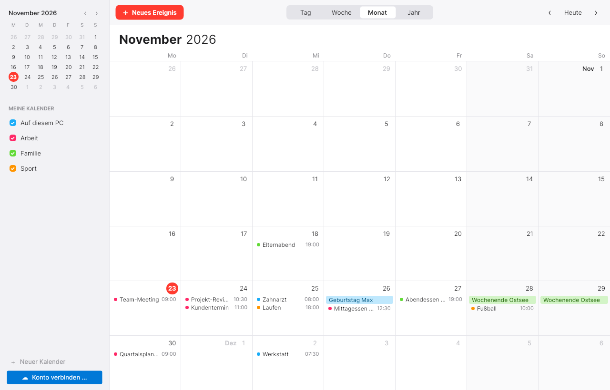

# Kalendra

Ein schlanker Kalender für Windows mit Zwei-Wege-Abgleich zu **iCloud** und **Google Kalender**.
Was du am PC einträgst, erscheint auf Mac und iPhone, und umgekehrt.



## Funktionen
- Tag-, Wochen-, Monats- und Jahresansicht, Mini-Monat, Kalender ein-/ausblenden
- Termine anlegen, bearbeiten, verschieben (Drag & Drop), ganztägig, Ort, Notizen
- **iCloud** per CalDAV (Apple-ID + app-spezifisches Passwort)
- **Google** per CalDAV mit eigener OAuth-Anmeldung im Browser, oder einfach per
  „Privatadresse im iCal-Format“ (nur anzeigen), siehe [Anleitung](docs/ANLEITUNG-GOOGLE.md)
- Wiederkehrende Termine, Zeitzonen, Ausnahmen; Zusatzfelder von Apple bleiben erhalten
- Arbeitet offline, gleicht ab, sobald wieder Netz da ist
- Zugangsdaten werden mit Windows DPAPI verschlüsselt und nur lokal gespeichert
- Installer (ohne Administratorrechte) oder portable Version für den USB-Stick

## Download
Unter [Releases](../../releases). Neue Versionen baut GitHub selbst: Actions → Release → „Run workflow“, Version eintragen.
- `Kalendra-Setup-<Version>.zip`: entpacken, Setup starten
- `Kalendra-<Version>-Portable.zip`: entpacken, `Kalendra.exe` starten, Daten liegen im Ordner `Daten`

Windows zeigt beim ersten Start evtl. „Der Computer wurde durch Windows geschützt“, weil die
Programme nicht signiert sind: „Weitere Informationen“ → „Trotzdem ausführen“.

## Selbst bauen
Voraussetzung: .NET 8 SDK.
```
dotnet publish src/Kalendra -c Release -r win-x64 --self-contained true -p:PublishSingleFile=true -p:IncludeNativeLibrariesForSelfExtract=true -p:EnableCompressionInSingleFile=true -o publish
makensis -DVERSION=1.0.1 -DSRC=../publish installer/kalendra.nsi
```
Technik: C# / .NET 8, [Avalonia](https://avaloniaui.net) 11, [Ical.Net](https://github.com/rianjs/ical.net).

## Tests
`tools/SyncTest` prüft den Abgleich gegen einen lokalen CalDAV-Server ([Radicale](https://radicale.org))
und einen nachgebauten Google-Server (`tools/FakeGoogle`):
```
pip install radicale
tools/radicale-reset.sh
cd tools/SyncTest
TZ=Europe/Berlin KALENDRA_DATA_DIR=/tmp/kd KALENDRA_CALDAV_URL=http://127.0.0.1:5232/ \
KALENDRA_GOOGLE_CALDAV_URL=http://127.0.0.1:5240/ KALENDRA_GOOGLE_AUTH_URL=http://127.0.0.1:5240/auth \
KALENDRA_GOOGLE_TOKEN_URL=http://127.0.0.1:5240/token dotnet run
```

## Hinweis
Kalendra ist ein unabhängiges Projekt und steht in keiner Verbindung zu Apple oder Google.
iCloud ist eine Marke von Apple Inc., Google Kalender eine Marke von Google LLC.

Lizenz: MIT
